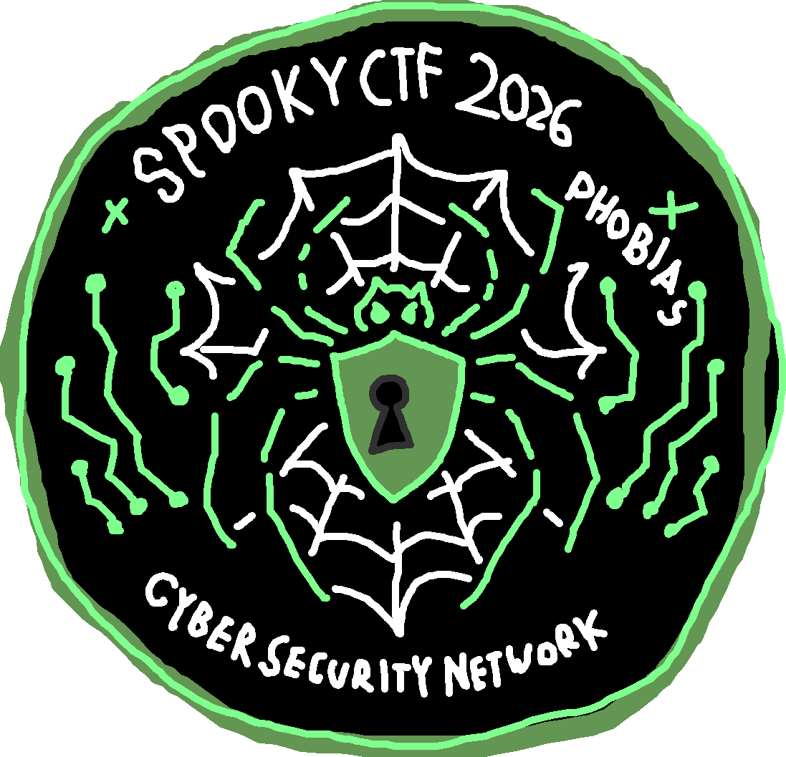
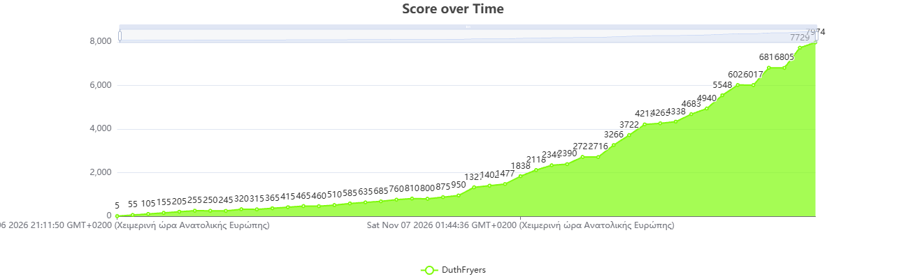
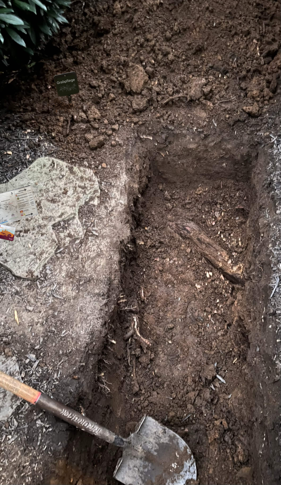
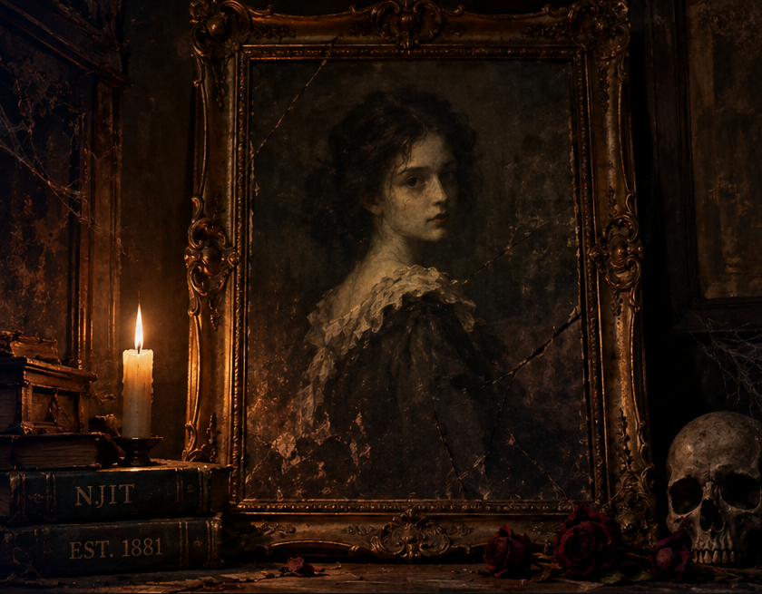

  

# 🎃 SpookyCTF 2026 — Team DuthFryers

Write-ups for every challenge our team solved at **SpookyCTF 2026** (NJIT, Nov 6–7 2026).

**Final placing:** 29th — **7974 points**
**Members:** Krepas (captain), fryer848

Each challenge lives in its own folder with the full write-up (`README.md`) and the original challenge files next to it; challenges with no downloadable artifact are a single `.md`. Flags use the format `spooky{...}` unless a challenge states otherwise.

  

## 🖼️ A few of the challenges

<table>
  <tr>
    <td align="center" width="33%">
       
      <b>MIA</b> · osint geolocate the grave from one photo
    </td>
    <td align="center" width="33%">
       
      <b>Ichthyophobia</b> · osint find the plaza from a dream drawing
    </td>
    <td align="center" width="33%">
       
      <b>The Haunted Portrait</b> · forensics bit-plane stego + ROT13
    </td>
  </tr>
</table>

---

## binrev

| Challenge | Pts | Flag | Write-up |
|---|---|---|---|
| Cyberphobia: Overflowed Bits | 50 | `spooky{br4v3Se@O77er}` | [link](binrev/cyberphobia-overflowed-bits/) |
| Too Much Love is Scary | 50 | `spooky{m4yb3_1_n33d_t0_10v3_mys31f}` | [link](binrev/too-much-love-is-scary/) |
| Frankenstein's Password Generator | 75 | `spooky{its_alive_at_midnight}` | [link](binrev/frankensteins-password-generator/) |
| Cyberphobia: Formatting Nightmare | 75 | `spooky{f0rm4tStr1ngVulN3r4b1lityIsSc4rY}` | [link](binrev/cyberphobia-formatting-nightmare/) |
| Trypophobia | 75 | `spooky{ever_reversed_java?A67b_91}` | [link](binrev/trypophobia/) |
| Elves can be Spooky Too | 377 | `spooky{phdr_in_ehdr_c2d021cc4fc5}` | [link](binrev/elves-can-be-spooky-too/) |

## crypto

| Challenge | Pts | Flag | Write-up |
|---|---|---|---|
| Heads will Roll | 50 | `spooky{5l33py_h0ll0w_h34d5}` | [link](crypto/heads-will-roll/) |
| Numerophobia | 50 | `spooky{th3_4n5w3r_h45_4lw4y5_b33n_42}` | [link](crypto/numerophobia/) |
| Cyberphobia: SpOoKy KeYsTrEaMs | 50 | `spooky{cs351JKS}` | [link](crypto/cyberphobia/) |
| I Feel Like Someone's Watching Me | 50 | `spooky{eyez_are_watching_me}` | [link](crypto/i-feel-like-someones-watching-me/) |
| Diagraphephobia | 75 | `spooky{qaStaH_nuq}` | [link](crypto/diagraphephobia/) |
| No Nonsense on this Server | 222 | `spooky{reused_k_no_nons3nse_89f3ae32316e}` | [link](crypto/no-nonsense-on-this-server/) |
| I D0n't Feel S0 G00d | 245 | `spooky{poison_is_bag_for_you}` | [link](crypto/i-dont-feel-so-good/) |
| Klediophobia | 456 | `spooky{4T_L345T_1T_15NT_F0UR}` | [link](crypto/kleidiophobia/) |
| There is no good name for the fear of math. | 474 | `spooky{scary_nonassociative_diffie_hellman}` | [link](crypto/there-is-no-good-name-for-the-fear-of-math/) |
| The Logical Way | 608 | `spooky{vtosh_katur_nirak}` | [link](crypto/the-logical-way/) |

## forensics

| Challenge | Pts | Flag | Write-up |
|---|---|---|---|
| The Haunted Portrait | 50 | `spooky{portraits_keep_secrets}` | [link](forensics/the-haunted-portrait/) |
| Arachnophobia | 50 | `spooky{8_l3gs_4nd_4_z1p}` | [link](forensics/arachnophobia/) |
| Tormented Tanny | 50 | `spooky{tormented_tanner_hates_his_vetsulin}` | [link](forensics/tormented-tanny/) |
| Eisoptrophobia | 50 | `spooky{the_reflection_never_lies}` | [link](forensics/eisoptrophobia/) |
| The Phantom Login | 75 | `spooky{the_ghost_left_a_trace}` | [link](forensics/the-phantom-login/) |
| Cleithrophobia | 75 | `Spooky{Be0m_Me_Up_Sc0tty_2266}` | [link](forensics/cleithrophobia/) |
| Stash the Hash | 75 | `spooky{dleeds_isa_devil}` | [link](forensics/stash-the-hash/) |
| Phasmophobia | 331 | `spooky{OOOGABOOGABOOGABOOspoopedBOOgotyou}` | [link](forensics/phasmophobia/) |
| Peering Eyes | 793 | `spooky{th3y_ar3_w2tch1ng}` | [link](forensics/peering-eyes/) |

## misc

| Challenge | Pts | Flag | Write-up |
|---|---|---|---|
| Gelotophobia | 50 | `spooky{th4t_w4snt_funn3h}` | [link](misc/gelotophobia.md) |
| Xenoglossophobia | 75 | `spooky{mu1tipl3_l@ngu@ges}` | [link](misc/xenoglossophobia.md) |
| Demented Memories | 345 | `spooky{the_g00d_the_l0st_@nd_th3_void}` | [link](misc/demented-memories/) |
| The Model Knows | 361 | `SPOOKY{spooky_vault_bones_and_bytes_2026}` | [link](misc/the%20model%20knows.md) |
| Drown in Memory | 924 | `spooky{!NjEc70R-P0wer-u5eR}` | [link](misc/drown-in-memory/) |

## osint

| Challenge | Pts | Flag | Write-up |
|---|---|---|---|
| Nosocomephobia | 50 | `spooky{north_wales_hospital.1966}` | [link](osint/nosocomephobia/) |
| Ichthyophobia | 280 | `POSTO_DECIO_UBERLANDIA` | [link](osint/ichthyophobia/) |
| Visiobibliophobia | 491 | `spooky{th1s_m1rr0r_i5_w0rldw1d3}` | [link](osint/visiobibliophobia.md) |
| MIA | 550 | `spooky{Friedhof_Bad_Harzburg}` | [link](osint/mia/) |

## web

| Challenge | Pts | Flag | Write-up |
|---|---|---|---|
| J*b Application | 50 | `spooky{l0v3_ai&j0b_4pplic4t10ns}` | [link](web/job-application/) |
| Hemophobia | 50 | `spooky{Sepultura}` | [link](web/Hemophobia/Hemophobia_writeup.md) |
| Scopophobia | 257 | `spooky{Th3_fe3d_goe5_b07H_way$}` | [link](web/scopophobia.md) |

---

