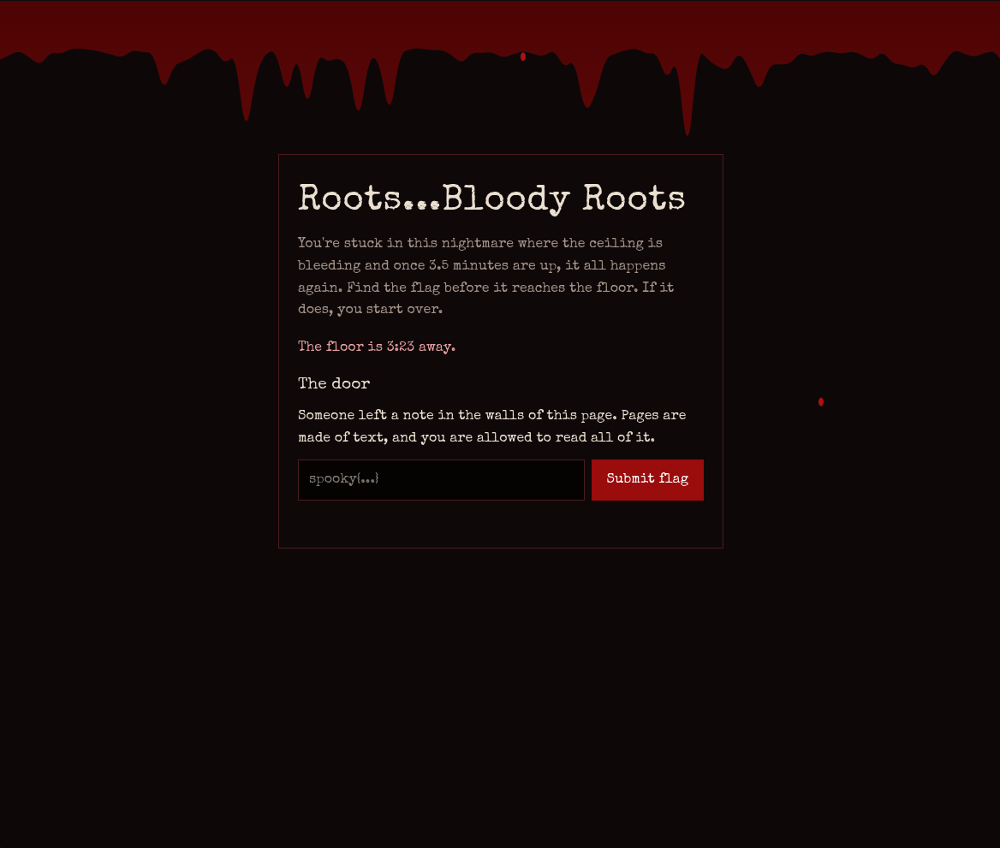
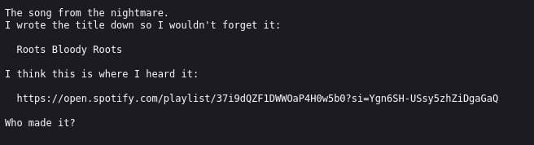
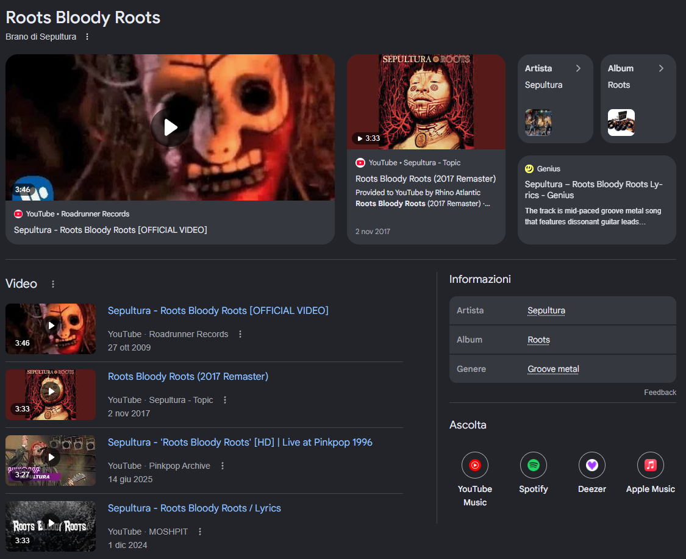

# Hemophobia

**Category:** Web / OSINT  
**Author:** flamboy_ant

## Challenge Description

> You are trapped in this endless nightmare with music and blood seeping in through the ceiling, crawling down the walls. Once the blood reaches the bottom, your feet become rooted to the ground as the blood consumes you, and you relive it all over again. To escape you must find the key hidden within these walls, and only then can you escape this nightmare. Goodluck...

## Solving the Challenge

### Step 1: Exploring the Website

I started by visiting the website at the address given in the challenge: `http://77.112.83.127`



The page shows a bleeding ceiling, a countdown and a flag submission form.
Right under the title, there is a note:

> Someone left a note in the walls of this page. Pages are made of text, and you are allowed to read all of it.

This sentence is a strong hint. "The walls of this page" most likely means the HTML source code, so that is where I looked next.

I opened the page source and found an HTML comment:
```html
<!-- There's a song that plays in this nightmare, but it's no longer here...
I wrote it down somewhere though. I think it's in nightmare.txt...
The flag looks like spooky{band} -->
```
This comment gives us two useful pieces of information:
1. A file called `nightmare.txt` probably exists on the web server.
2. The flag format is `spooky{band}`, so the answer is the name of a band.


### Step 2: Reading `nightmare.txt`

Next, I requested the file directly: `http://77.112.83.127/nightmare.txt`

The file contains:



The file gives us the song title, **Roots Bloody Roots**, and ends with the question *"Who made it?"*. 

### Step 3: Identifying the Band

I searched for the song title on Google.



Google shows that *Roots Bloody Roots* is a song by **Sepultura**, from the 1996 album *Roots*

### Step 4: Submitting the Flag
Using the format found in the HTML comment, the flag is **spooky{Sepultura}**

## Bonus Track
Here's the Spotify link to the song **Roots Bloody Roots**, give it a listen.

[Listen on Spotify](https://open.spotify.com/track/6ursmCnbc9oDRGa2yHKkoZ?si=1fac3f10d10d482b)